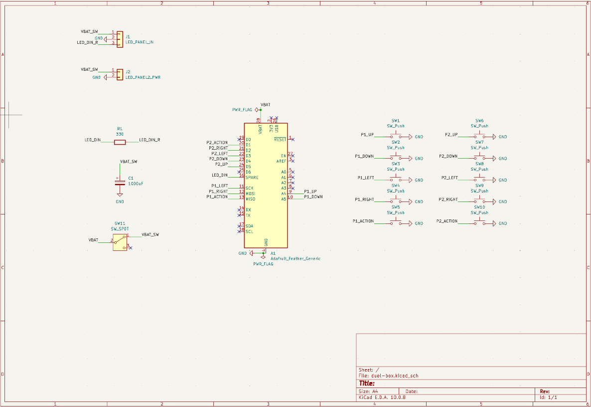

# duel box

hii!! this is my first fallen project, duel box, a two player handheld!

## woah what does it do?

i'm glad you asked. it's got two control sections, one for each player!
hold your end, get a friend, and battle until the... end. i ran out of rhymes

each player gets a dpad for movement and an action button for... actions, generally.

the games that are planned for it are as follows

- isolation
- connect four
- pong

## ok why'd you make this though

i've basically never done any hardware stuff outside of a freshman class where i soldered like 5 parts together.
this is me trying it out! and hopefully learning some useful stuff while i make some cool stuff and inevitably run into some stupid stuff.
but that's the fun, obviously. and i am having fun so mission accomplished i guess lol

oh and i want to go to shenzhen ofc it'd be the first really cool place i've been to

## hardware?!

yes hardware. i know.

- adafruit feather rp2040
- adafruit neomatrix 8x8 x2
- 12mm tactile buttons x10
- 2000mAh lipo
- 330ohm resistor
- 1000uF capacitor
- slide switch
- connectors for panels x2
- female headers to socket the feather
- custom pcb
- back plate (acrylic, probably)
- standoffs and screws
- rubber feet for tabletop shenanigans
- wire for connecting panels
- spare lipo because it takes a while to charge

## you made a schematic?!

yeah!!!!!!

## pcb?!?!

coming sooooon

## 3d model?!?!?!

coming less sooooonnnnn

---
tysm for reading! i hope you enjoyed.